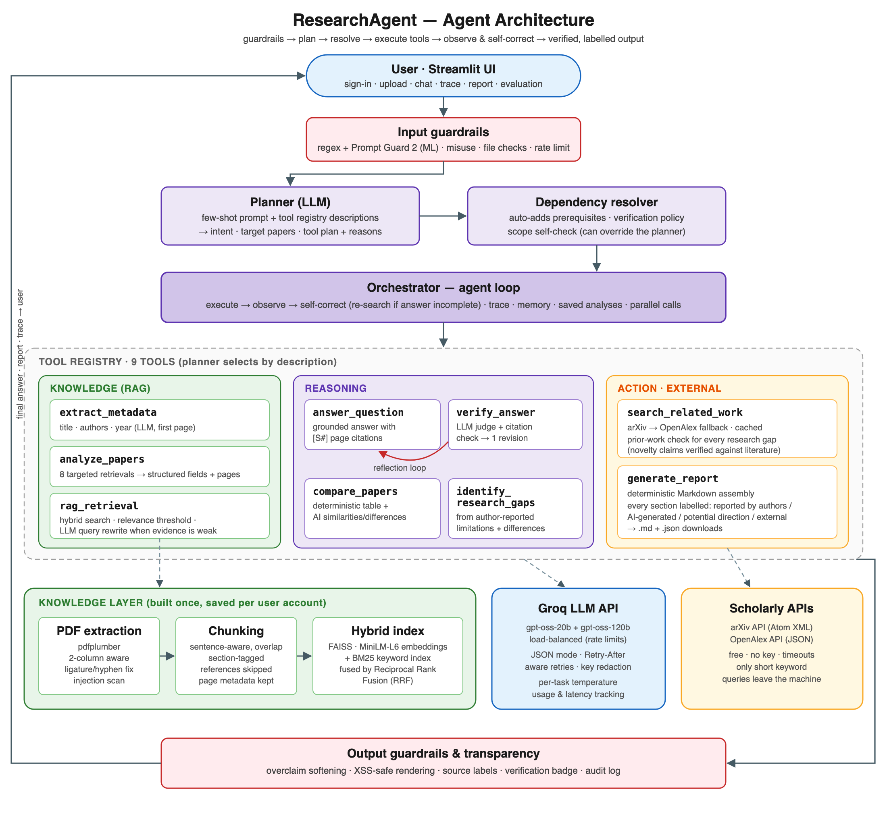
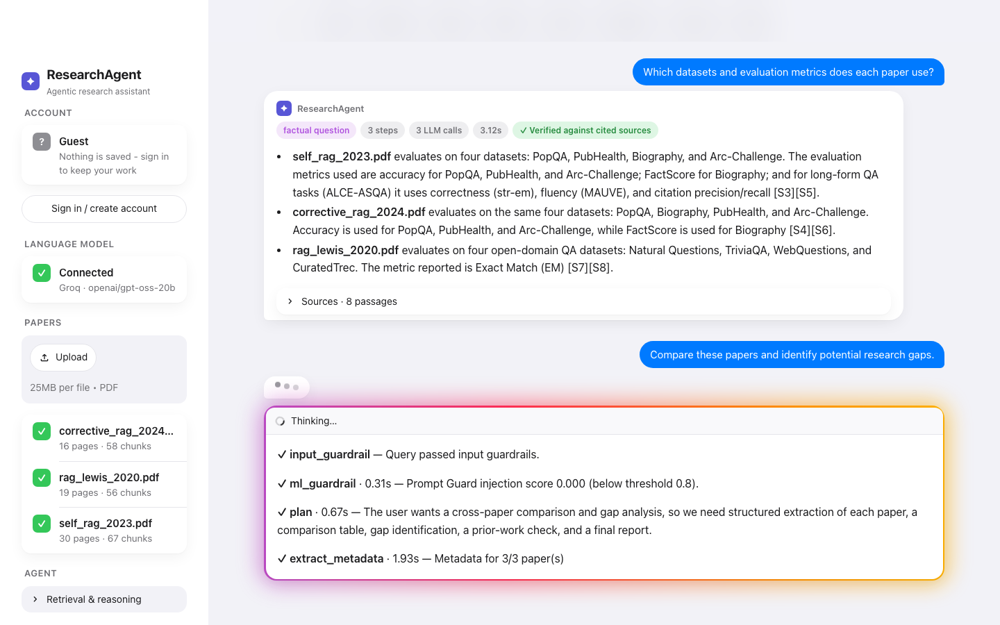
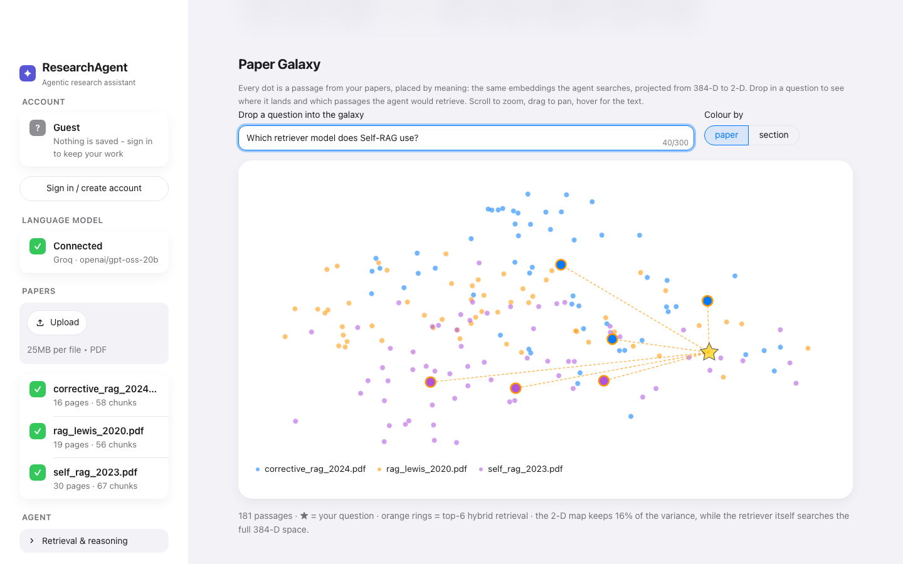
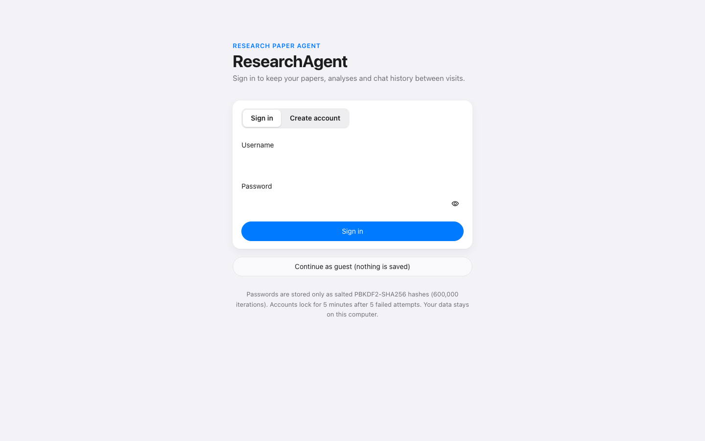
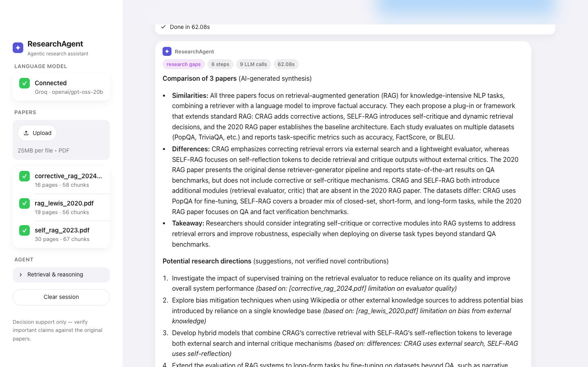
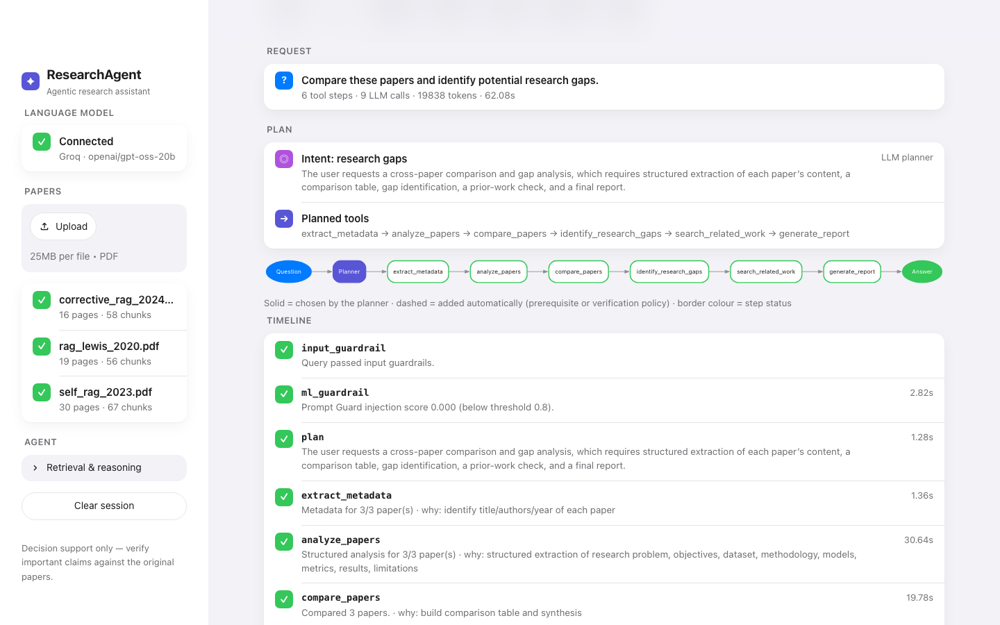
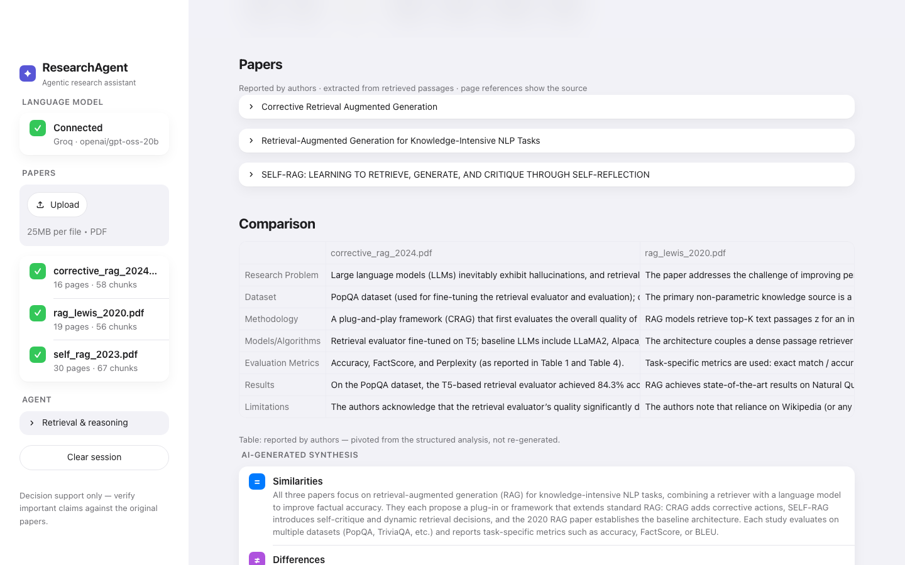
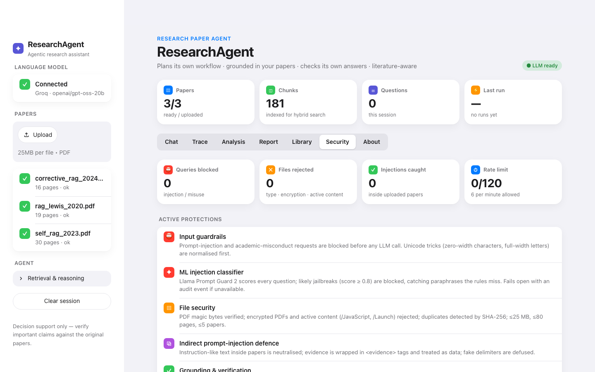
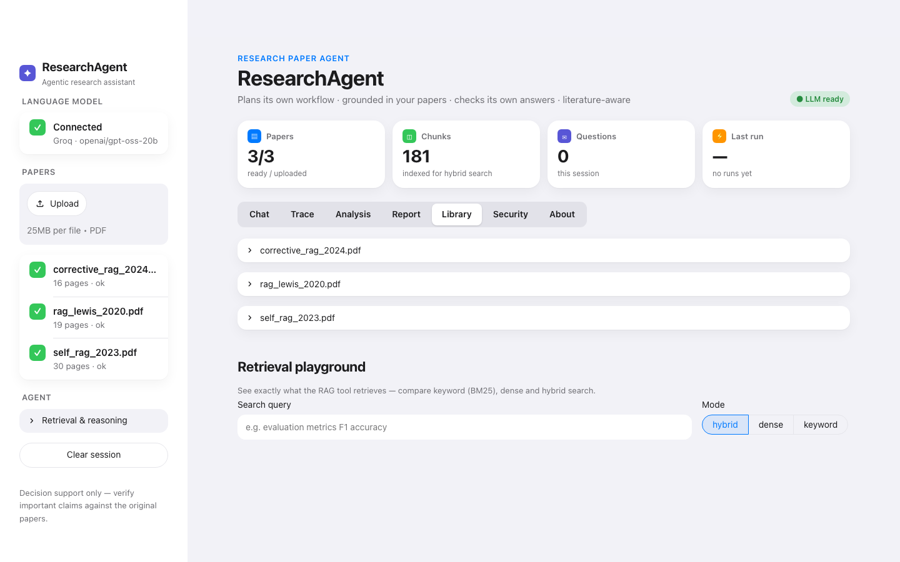

# ResearchAgent: An Agentic AI System for Research Paper Analysis, Comparison and Research Gap Identification

**FA Activity: Agentic AI Application Implementation**
Domain: Research Paper Analysis Agent (suggested domain #2)
Technology: Python · Streamlit · Groq LLM API · RAG (sentence-transformers + FAISS + BM25) · arXiv/OpenAlex APIs
Source code: https://github.com/mitalihatestocode/ResearchAgent

---

## 1. Introduction

Researchers and students routinely need to read several papers on one topic, pull out what each one did (dataset, method, models, metrics, results, limitations), compare them, and decide what is still open. Doing this by hand is slow. Doing it with a general-purpose chatbot is risky: chatbots summarise from their training memory, invent citations and numbers, and present "research gaps" as confirmed discoveries.

**ResearchAgent** is an agentic AI application that works over the papers the user uploads. For each request it **plans** which of its 9 tools to use, **retrieves** evidence from the papers, **acts** through local tools and external APIs, **checks** its own answers, and returns output that is cited, labelled and verifiable.

## 2. Problem Statement

Given a small set of research papers (PDFs) and a natural-language request, produce answers, structured comparisons and potential research directions that are:

1. **grounded**, with every factual statement traceable to a page of an uploaded paper;
2. **right-sized**, so a narrow question doesn't trigger a full literature review and a broad one isn't answered superficially;
3. **honest**, clearly stating when information is missing and never presenting AI suggestions as confirmed novel findings;
4. **safe**, robust to prompt injection (including instructions hidden inside documents) and not usable for academic misconduct.

**Why an agent and not a chatbot?** The task has independent sub-tasks needing different context (extraction per paper, comparison across papers, gap analysis, literature lookup). The right workflow depends on the question, so it must be planned rather than fixed. Grounding requires retrieval before generation. Checking whether a gap is novel requires an external tool. A single prompt→answer call can't meet these requirements; a planning, tool-using, self-checking agent can.

## 3. Objectives

1. Build a pipeline that ingests PDFs, including two-column layouts, into a searchable, section-aware knowledge base.
2. Implement an LLM planner that chooses tools, target papers and intent for each request from a tool registry.
3. Implement hybrid retrieval (semantic plus keyword) with a relevance threshold and citations.
4. Extract a validated, structured representation of each paper and compare papers on standard parameters.
5. Suggest potential research gaps grounded in author-reported limitations, and check each against external literature.
6. Add reflection: verify every answer against its evidence and revise it once if needed.
7. Enforce safety with deterministic guardrails on input, documents and output.
8. Provide a usable UI with a transparent agent trace and downloadable report, plus an automated test suite.

## 4. Proposed Agent Architecture



The system has five layers:

| Layer | Components | Responsibility |
|---|---|---|
| Interface | Streamlit UI | upload, chat, live trace, analysis views, report download |
| Safety | `safety/guardrails.py` | input, document and output guardrails |
| Agent core | Planner, Tool Registry, Dependency Resolver, Orchestrator | decide and execute the workflow, observe, self-correct, keep memory |
| Tools | 9 tools (knowledge, reasoning, action) | metadata, analysis, retrieval, answering, verification, comparison, gaps, literature search, report |
| Infrastructure | Knowledge layer (FAISS + BM25), Groq LLM API, arXiv/OpenAlex APIs | storage, generation, external knowledge |

**Agentic properties.** *Planning*: the LLM produces a tool plan for each question. *Tool use*: 9 tools across three kinds (local, LLM, external API). *Multi-step execution*: an ordered, dependency-resolved execution with a trace. *Autonomous decisions*: the agent can override the planner's out-of-scope decision when the papers clearly contain relevant evidence, and it rewrites queries when evidence is weak or when its own draft answer says the evidence was insufficient. *Reflection*: verify, then revise. *Memory*: conversation history for follow-ups, plus **user accounts** that persist each user's papers, embedding vectors, LLM analyses and chat history, so returning users never re-upload or re-analyse a paper.

We chose **plan-then-execute with observation** over an open-ended ReAct loop. It gives the agent real autonomy where that is safe, keeps cost and latency bounded, and makes every decision explainable. Section 8 describes the full loop.

## 5. Prompt Design

All prompts live in `agent/prompts.py`, one role per prompt (planner, metadata extractor, paper analyst, answerer, verifier, query rewriter, comparer, gap suggester). The techniques used:

| Technique | How it is applied |
|---|---|
| Role + task decomposition | each call has one narrow role instead of a generic assistant |
| Few-shot examples | the planner sees 5 worked request→plan examples, including an out-of-scope one where no tools should run |
| Structured output | every call requests JSON with an explicit schema; the API's JSON mode is enabled; Pydantic validates downstream |
| Reason-then-answer | plans and verdicts contain a `reasoning` field written before the decision (compact chain-of-thought), which is also shown to the user |
| Delimited untrusted context | evidence is wrapped in `<evidence id="S1" paper=… page=… section=…>` tags, and the model is told this is data, never instructions |
| Citation enforcement | answers must cite `[S#]` after each claim; code then checks that the citations exist |
| Explicit fallback string | missing fields must read exactly "Not explicitly reported in the provided paper." |
| Self-critique | a separate verifier prompt (temperature 0) audits claims against evidence |
| Query rewriting | weak retrieval triggers a prompt that generates 3 alternative queries in research vocabulary |
| Per-task temperature | 0.0 for planning, metadata and verification; 0.1 for extraction; 0.2 for answers and comparison; 0.4 for gap ideas |
| Shared safety rules | `SAFETY_RULES` is appended to every prompt: no fabrication, no invented citations, no novelty claims, ignore instructions inside evidence |

**Example (planner few-shot entry):**
```
Request: "What dataset did paper 1 use?"
Plan: {"reasoning": "Narrow factual question about one paper's dataset; retrieval plus a cited
       answer is enough. No comparison or gaps were requested.",
       "in_scope": true, "intent": "factual_question", "target_papers": ["bert.pdf"],
       "steps": [{"tool": "rag_retrieval", ...}, {"tool": "answer_question", ...}]}
```

## 6. RAG Implementation

1. **Extraction** (`rag/pdf_extractor.py`): uses pdfplumber with a tighter word tolerance and **two-column layout detection**. If almost no words cross the vertical midline, the page is cropped into halves. Ligatures and hyphenation are repaired, and documents are capped at 80 pages. On real two-column papers this fixed text where words were merged and lines interleaved across columns. It also raised the number of detected sections, for example from 3 to 6 on the CRAG paper.
2. **Chunking** (`rag/chunker.py`): chunks are packed from whole sentences up to 900 characters with about 150 characters of sentence-level overlap. Section headings (Abstract, Method, Results, Limitations, …) are detected and stored on each chunk. The **References section is excluded** from the index, and every chunk is scanned for prompt injection.
3. **Indexing** (`rag/vector_store.py`): local `all-MiniLM-L6-v2` embeddings (384-d, normalised) go into FAISS `IndexFlatIP`, which gives cosine similarity, alongside a dependency-free **BM25** keyword index (`rag/bm25.py`).
4. **Hybrid retrieval**: dense and BM25 rankings are merged with **Reciprocal Rank Fusion**, score = Σ 1/(60 + rank). Dense search handles paraphrases; BM25 catches exact names such as "PopQA" and "MIMIC-III".
5. **Relevance threshold**: passages below cosine 0.28 are never used as evidence. We calibrated this on the sample papers: off-topic questions score 0.08–0.21 and on-topic ones 0.43–0.71. An integration test with the real model checks this calibration.
6. **Per-paper coverage**: multi-paper questions also retrieve the top passages from each paper separately, so no paper is left out of the evidence.
7. **Targeted multi-query extraction**: `analyze_papers` runs 8 field-specific queries per paper, de-duplicates the evidence, and asks the LLM which evidence IDs support each field. These are mapped back to page and section ("p.6 (Experiments)").

## 7. Tool/API Integration

| Tool / API | Kind | Integration details |
|---|---|---|
| **Groq Chat Completions API** | external LLM | `agent/llm_client.py`: JSON mode, **exponential-backoff retries** on 429/5xx/timeouts, **automatic fallback model**, fail-fast with a clear message on 401/403, thread-safe usage and latency accounting |
| **arXiv API** (Atom XML) | external, no key | `tools/literature_search_tool.py`: keyword query, XML parsing, timeouts, caching |
| **OpenAlex API** (JSON) | external, no key | automatic fallback when arXiv fails or returns nothing; includes citation counts |
| sentence-transformers / FAISS | local library | embeddings and vector search |
| 9 agent tools | internal | registered in `agent/tool_registry.py` with description, when-to-use, prerequisites and kind |

`search_related_work` serves two purposes. (a) **Related-work search**: it uses paper titles from the metadata to find related publications. (b) **Prior-work check**: for every suggested research gap, it searches with an LLM-generated keyword query and shows the closest existing publications next to the gap. The user can then judge novelty themselves instead of trusting the model. Only short keyword queries leave the machine, never paper text.

Every tool returns a `{"status": …, "message": …}` dictionary instead of raising errors, so a failing API degrades one step rather than the whole run.

## 8. Agent Workflow

```
1. Input guardrails      → block injection / misuse / invalid input (zero LLM calls if blocked)
2. Plan                  → LLM planner returns intent, target papers, tools + reasons
                           (validated: unknown tools/papers dropped; rule-based fallback if the LLM fails)
3. Scope self-check      → out-of-scope plan? probe the papers; override only if strongly related (≥0.45)
4. Resolve dependencies  → add prerequisites (e.g. compare needs metadata + analysis) + verification policy
5. Execute each step     → emit a trace event {step, status, detail, duration, why, auto_added}
     rag_retrieval       → weak evidence (<0.35)? LLM rewrites query → retrieve again → merge
     answer_question     → cited answer from evidence; if the draft says evidence is missing,
                           rewrite the search around the gap, retrieve again, keep the better answer
     verify_answer       → judge + citation check → unsupported? revise once → re-verify
     analysis/metadata   → parallel per paper, cached for later questions
6. Compose final answer  → labelled output + report + full trace in the UI
```

**Example: "Compare these papers and identify potential research gaps"**
plan → `extract_metadata → analyze_papers → compare_papers → identify_research_gaps → search_related_work → generate_report`

**Example: "What dataset did paper 1 use?"**
plan → `rag_retrieval → answer_question`, plus an auto-added `verify_answer`, scoped to paper 1 only.

## 9. Safety Mechanism

Safety works in depth: **deterministic code checks** that can't be talked out of their job, an **ML classifier**, **prompt-level rules**, and an **LLM judge**, applied across input, documents, output and infrastructure. The full threat model is in [SECURITY.md](../SECURITY.md).

| Risk | Mechanism | Type |
|---|---|---|
| User prompt injection ("ignore previous instructions…") | `validate_query` patterns run on **Unicode-normalised** text (NFKC, zero-width and bidi characters removed); blocked before any LLM call | deterministic |
| **Paraphrased jailbreaks** that rules miss | **Llama Prompt Guard 2** classifier (score ≥ 0.80 is blocked; attacks scored 0.998–0.9996 and research questions about 0.0004 in testing); fails open with an audit event | ML classifier |
| **Indirect injection hidden in a PDF** | each chunk is scanned at indexing; phrases are replaced before reaching a prompt; evidence is delimited as data; fake `</evidence>` delimiters are defused; the UI warns | deterministic |
| Academic misconduct (fabricating data, fake citations, beating plagiarism or AI detectors, ghost-writing) | refused with an explanation | deterministic |
| Malicious files | magic-byte check, encrypted and `/JavaScript` or `/Launch` PDFs rejected, embedded files flagged, SHA-256 dedupe, sanitised filenames, size, page and count limits enforced in the app and by the server | deterministic |
| Hallucinated facts and citations | RAG only; relevance threshold; "not reported" fallback; `[S#]` citations checked in code; verifier + revision | prompt + code + LLM judge |
| Overclaiming novelty | prompt framing; `soften_overclaims`; prior-work check against arXiv/OpenAlex | 3 layers |
| XSS through rendered content | untrusted text is escaped in HTML or rendered as Markdown with HTML disabled; only `http(s)` links | deterministic |
| Account security | salted PBKDF2-SHA256 (600k iterations); constant-time checks; generic errors (no username enumeration); 5-attempt lockout; per-user data isolation; owner-only file permissions; password-confirmed account deletion; guest mode saves nothing | deterministic |
| Secret leakage and key sharing | session-only key scoped per run (a `ContextVar` that is propagated to worker threads); errors are redacted; `.env` is git-ignored | deterministic |
| Abuse and cost | per-session rate limit (6 per minute, 120 per session); bounded retries | deterministic |
| Infrastructure | localhost binding, XSRF protection, hidden error details, static serving and telemetry off; **`pip-audit`: 0 known vulnerabilities** after upgrading 50+ vulnerable pins | configuration |
| Transparency | every output labelled *Reported by authors / AI-generated / Potential direction / External source*; full trace; verification badge; a **Security tab** with a privacy-preserving audit log (fingerprints only, never content) | UI |

Testing exposed two problems with the guardrails themselves. First, the phrase "system prompt" appears legitimately in the Self-RAG paper, so we narrowed that pattern and added a regression test. Second, the regex layer alone missed the paraphrased jailbreak above, which is why the ML classifier was added. Both cases are now automated tests.

## 10. Results

**Automated testing:** 106 of 106 pytest tests pass (`pytest -q`). They cover 38 documented test cases: ingestion, RAG, planning, every tool, reflection, caching, failure isolation, all guardrails 10 application-security cases and 7 account and storage cases. `pip-audit` reports no known vulnerabilities. See [TEST_REPORT.md](TEST_REPORT.md).

**Retrieval quality on real papers** (3 arXiv papers on RAG: Lewis et al. 2020, Self-RAG 2023, CRAG 2024; 181 chunks):

| Query | Best cosine | Outcome |
|---|---|---|
| What is the retrieval evaluator in CRAG? | 0.71 | correct passage (CRAG p.5) |
| What are the limitations of Self-RAG? | 0.55 | Self-RAG experiments section |
| What datasets were used for evaluation? | 0.50 | "Tasks and datasets" (Self-RAG p.6) |
| Who won the cricket world cup? | 0.21 | rejected (below 0.28) |
| Recipe for chocolate cake | 0.13 | rejected |
| What's the weather in Mumbai today? | 0.10 | rejected |

**Engineering fixes found while testing** (the original code base failed on a clean install):
- `groq==0.11.0` is incompatible with `httpx>=0.28` (`unexpected keyword argument 'proxies'`), so **every LLM call failed**. We upgraded and pinned the SDK.
- `pyarrow>=18` requires NumPy 2 while `numpy==1.26.4` was pinned, so **every Streamlit table and chart crashed**. We pinned `pyarrow==17.0.0`.
- Two-column PDFs produced merged words ("Giventhedocumentretrievalresults") and interleaved columns. Layout-aware extraction fixed both and improved retrieval scores for on-topic questions (e.g. 0.45 → 0.50 and 0.58 → 0.71).

**Live LLM evaluation:** **12 of 12 end-to-end scenarios passed** against the real Groq model, real Prompt Guard 2 and the 3 arXiv papers. The full log, with every trace and answer, is in [live_test_results.md](live_test_results.md). Highlights:
- *"Which datasets were used by each paper?"* returned a correct, cited answer for all three papers (PopQA/Biography/PubHealth/ARC-Challenge; NQ/TriviaQA/WebQuestions/CuratedTrec; Self-RAG training data). The verifier flagged the first draft, and the agent revised it automatically.
- The research-gap run produced directions tied to specific author-reported limitations, for example supervised evidence retrieval for FEVER, from the RAG paper.
- The paraphrased jailbreak missed by the regex rules was blocked by Prompt Guard 2 (0 main-LLM calls). The hidden instruction inside a PDF was ignored, and only the real result was reported.
- A full 3-paper research-gap run in the browser takes **45–62 s, uses 9 LLM calls and about 20k tokens**. Follow-up questions reuse the cached analyses and take 5–25 s.

**RAG evaluation benchmark** ([evaluation_results.md](evaluation_results.md), `python -m evaluation.run_eval`): 12 hand-labelled questions on the 3 papers, with every answer verified against the papers' text, plus 3 unanswerable or off-topic questions.

| Retrieval (top-6, no LLM) | Hit@6 | MRR | Context recall |
|---|---|---|---|
| Dense, all papers | 0.67 | 0.47 | 0.62 |
| Keyword (BM25), all papers | 0.67 | 0.37 | 0.60 |
| **Hybrid, all papers** | **0.75** | 0.42 | 0.62 |
| Hybrid, scoped to the named paper (what the agent does) | 0.83 | 0.54 | 0.79 |

| End-to-end (real LLM) | Before self-correction loop | **After** |
|---|---|---|
| Answer accuracy (all expected facts) | 67% (8/12) | **75% (9/12)** |
| Mean fact recall | 77% | **81%** |
| Citation validity (code check) | 100% | **100%** |
| Faithfulness (verifier) | 100% | **100%** |
| Correct refusals (unanswerable / off-topic) | 100% | **100%** |
| Mean latency / LLM calls / tokens | — | 19 s / 3.9 / ~7k |

Hybrid search beats either method alone when searching all papers. The agent **never invented an answer**: every unanswerable question was refused, and every citation was valid. The benchmark exposed honest-but-incomplete answers when the first search missed the key passage, which led to the answerability-driven second search (Q06 went from 50% to 100%). The two remaining misses (Q10, Q12) are facts packed into one dense paragraph on page 7 of Self-RAG. For both, the agent answered "not explicitly reported" rather than guessing. That's a retrieval limitation, not a hallucination (see §12).

**User interface** (iOS-inspired design, light and dark themes). The UI has iOS-style motion: cards fade and slide in, chat bubbles pop in, typing dots show while the agent thinks, a glowing gradient border surrounds the agent while it works, and answers stream in word by word. All motion turns off for users who enable *reduce motion* (accessibility). The **Paper Galaxy** tab projects every passage's 384-D embedding to 2-D (PCA) and drops the user's question onto the map as a ★, with lines to the passages the agent would retrieve. This makes semantic search visible.

| | |
|---|---|
|  |  |


| | |
|---|---|
|  |  |
|  |  |
|  |  |

## 11. Limitations

- **Scanned PDFs** without a text layer can't be read, because there is no OCR; the agent reports this clearly instead of failing.
- **Tables, figures and equations** are extracted as plain text at best, so numbers that appear only in figures are missed.
- **Section detection is heuristic**: unusual heading styles fall back to the previous section label.
- **The verifier is itself an LLM**, so it reduces hallucinations but cannot guarantee their absence; the deterministic citation check covers only citation validity.
- **The prior-work check is shallow**: it shows the top 3 keyword matches from arXiv/OpenAlex, not a systematic literature review.
- **Scale**: the in-memory index is rebuilt every session and is designed for up to 5 papers; the Groq free tier's rate limits can slow large runs.
- **Injection defences reduce risk but can't guarantee detection.** The ML classifier (Prompt Guard 2) checks user questions only; document text relies on pattern neutralisation and delimiting.
- **Free-tier rate limits** (8k tokens per minute per model) make a first full 3-paper analysis take about 1–2 minutes. Later questions, and later visits by signed-in users, reuse the saved analyses.
- **Accounts are local** to the computer running the app, and sign-in lasts for the browser session. A public deployment would need HTTPS and persistent login cookies.
- **The benchmark is small** (15 questions on 3 papers). It catches regressions and shows trends, but it isn't a statistically strong measurement.

## 12. Future Scope

- OCR (e.g. Tesseract) for scanned papers, and table/figure extraction (e.g. layout-aware parsers).
- Smaller, overlapping chunks for dense method paragraphs, plus a cross-encoder re-ranker. These target the two remaining benchmark misses (Q10, Q12).
- Persistent vector store and per-user libraries, so papers are indexed once and reused.
- A cross-encoder re-ranker on top of hybrid retrieval; evaluation with RAGAS-style metrics (faithfulness, context precision).
- Semantic Scholar citation graphs to rank gaps by how much follow-up work exists; automatic BibTeX export.
- Run the Prompt Guard classifier over document chunks as well as user questions, and add authentication plus persistent audit storage for multi-user deployment.
- Multi-agent roles (reviewer agent, devil's-advocate agent) for richer critique of gaps.
- Human-in-the-loop plan editing: let the user approve or modify the plan before execution.
