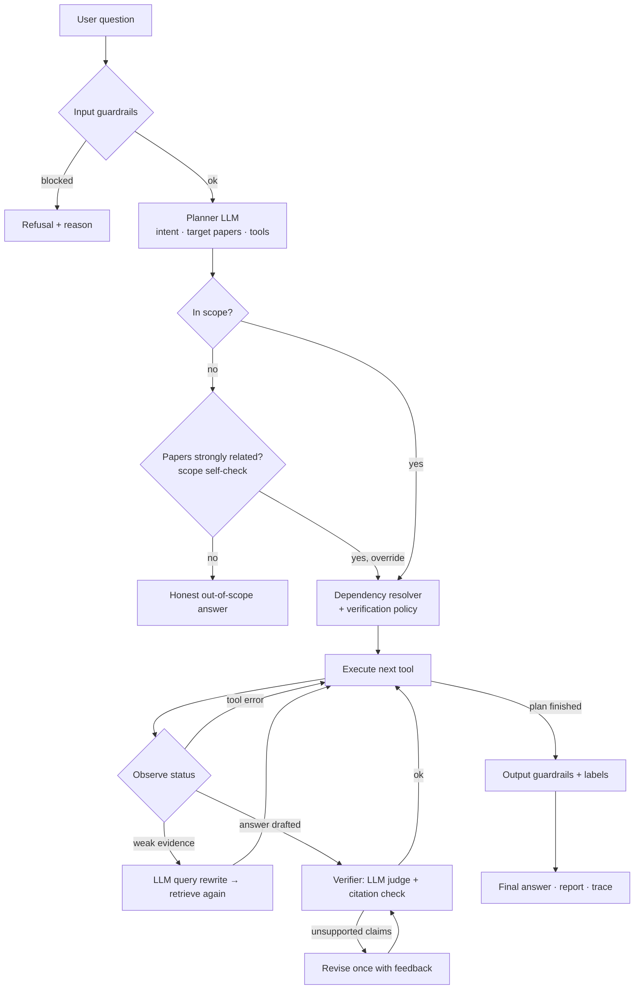

# ResearchAgent — Architecture

([SVG version](architecture.svg))

## Agent loop

## Tools

| Tool | Type | Requires | Purpose |
|---|---|---|---|
| `extract_metadata` | LLM | – | title, authors, year from the first page |
| `analyze_papers` | RAG + LLM | – | 8 targeted retrievals per paper → structured `PaperInfo` with page sources |
| `rag_retrieval` | local (+LLM rewrite) | – | hybrid search; rewrites the query when evidence is weak |
| `answer_question` | LLM | rag_retrieval | grounded answer, `[S#]` citations |
| `verify_answer` | LLM + code | answer_question | reflection: audit + one revision (added by policy) |
| `compare_papers` | code + LLM | metadata, analysis | deterministic table + similarities/differences |
| `identify_research_gaps` | LLM + guardrail | metadata, analysis | potential directions from author-reported limitations |
| `search_related_work` | external API | metadata | arXiv/OpenAlex related work; prior-work check per gap |
| `generate_report` | code | metadata, analysis | labelled Markdown report |

## Design decisions

**Plan-then-execute with observation, not a free-running ReAct loop.** The LLM plans once, then the orchestrator runs the plan. It still observes each step's status and corrects itself where that's safe: it rewrites the query, revises answers, and can override the planner's scope decision. This gives real autonomy without the main risks of an open-ended loop, such as repeated tool calls, runaway cost or a hung demo. Every decision is visible in the trace.

**Tool registry.** The planner sees each tool's name, description and when-to-use text, the same pattern as function calling. Each tool's prerequisites live in the registry, so even an imperfect plan always executes correctly.

**Hybrid retrieval.** Dense embeddings capture meaning, while BM25 catches exact tokens such as model names, dataset names, metrics and numbers. Research questions are full of these. Reciprocal Rank Fusion merges the two rankings without tuning weights. A cosine relevance threshold, calibrated on real papers (off-topic 0.08–0.21, on-topic 0.43–0.71, threshold 0.28), keeps weakly related text away from the LLM.

**Structured extraction before comparison.** Each paper becomes a validated Pydantic `PaperInfo`. The comparison table is pivoted from this data in plain Python, without another LLM call, so the table stays traceable to its source pages.

**Deterministic report.** The report assembles outputs that are already grounded and labelled. Re-generating them through an LLM would only add another chance to drift from the source.

**Local embeddings, hosted LLM.** Retrieval works offline and costs nothing. The LLM provider can be swapped by editing one file (`agent/llm_client.py`).

**Why not LangChain or CrewAI?** The brief allows either, but a small hand-written orchestrator keeps every step explainable in a viva, avoids heavy dependencies, and still implements the same patterns: tool registry, planner, executor and reflection.
